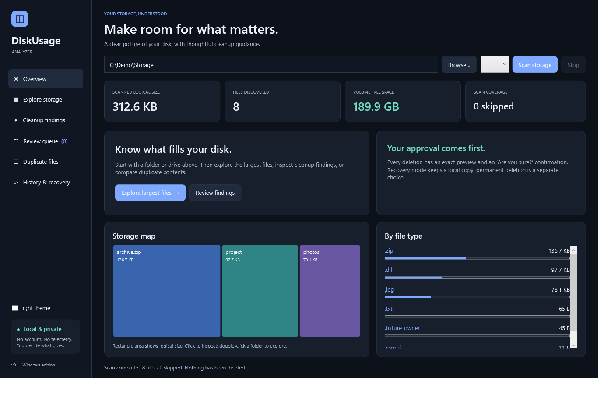

# DiskUsageAnalyzer

A native, local Windows disk space analyzer and cleanup manager. Understand what fills your disk, inspect explainable findings, compare duplicate contents, and decide exactly what goes.



**Every deletion requires an explicit Delete action and an “Are you sure?” confirmation.** Cancel is the default. There is no automatic cleanup, preselection, scheduled deletion, or confirmation bypass. Scanner and rules do not have mutation capabilities.

## Run

Windows 11 x64: extract the self-contained portable ZIP completely and open **DiskUsageAnalyzer.App.exe**, or use the per-user installer. No SDK, administrator access, account, or internet connection is needed. The initial packages are unsigned; verify `SHA256SUMS-0.1.0.txt` and expect Windows trust warnings.

Local build artifacts are generated in `artifacts/releases/`. This repository has not yet been published to GitHub; there is no public download URL.

## What it does

- Folder/drive scanning with bounded memory, local SQLite indexing, partial coverage and cancellation.
- Usage cards, a synchronized storage map, paged file exploration, largest files, file types, filtering and CSV reports.
- Plain-language temp, .NET build, JavaScript dependency, Python environment and pip-cache findings, with consequences and risk labels.
- Opt-in SHA-256 and byte-verified duplicate discovery; a retained, revalidated keeper protects the remaining copy.
- Exact file review, mandatory acknowledgment/confirmation, changed/locked/protected-file safeguards and per-item history.
- Default **local recovery folders** with non-overwriting Restore. This deliberately uses retained Windows file handles instead of a Shell Recycle Bin handoff. Recovery retains allocation; a separate confirmed permanent-delete action actually removes content.
- Dark/light/high-contrast styling, keyboard-accessible lists, automation labels, standard-user execution and no telemetry.

Read the [user guide](docs/USER_GUIDE.md), [safety design](docs/SAFETY.md), [privacy policy](PRIVACY.md), and [validation evidence/limits](docs/VALIDATION.md).

## Develop and verify

Install the SDK specified in `global.json` and PowerShell 7 to use the build/package scripts. A locally downloaded SDK in `.tools/dotnet` is also supported by the scripts.

```powershell
./eng/Build.ps1 -UiTests -Coverage
dotnet run --project src/DiskUsageAnalyzer.App
dotnet run --project benchmarks -c Release -- 100000 artifacts/benchmarks
./eng/Package.ps1 -Version 0.1.0 -Installer
```

Packaging requires the pinned Inno Setup compiler or `-Compiler <ISCC.exe>`. All dependency versions/integrity hashes are locked. Tests of cleanup use unique disposable fixtures and intentionally never recursively remove them automatically. The production-window UI harness exercises Cancel, modal close, approved recovery and permanent deletion on its own fixtures.

Optional application arguments: `--scan <folder>` sets the scan field and `--data-dir <folder>` changes the local application-data location. They do not authorize scanning or cleanup automatically; command-line deletion is unavailable.

## Status and limitations

This is the initial 0.1.0 implementation, prepared for a prerelease and field validation. Core cleanup supports regular files on fixed local NTFS volumes. Known cloud-sync paths, placeholders, reparse points, hardlinks and protected system areas are excluded. Cleanup does not prove that an environment/dependency is unused. Recovery folders/history are retained indefinitely, including after uninstall; permanent deletion has no built-in undo.

Named snapshots/import, administrator/MFT scans, browser profile cleaning, Docker/WSL pruning, servicing, scheduled cleanup and automatic updates are deferred. Independent clean-VM testing, Narrator review, publisher signing and public GitHub configuration remain release prerequisites; see [release instructions](docs/RELEASE.md). Git rollback cannot undo user filesystem deletion.

Licensed under [Apache-2.0](LICENSE). See [third-party notices](THIRD_PARTY_NOTICES.md), [contribution guidelines](CONTRIBUTING.md), and [security reporting](SECURITY.md).
